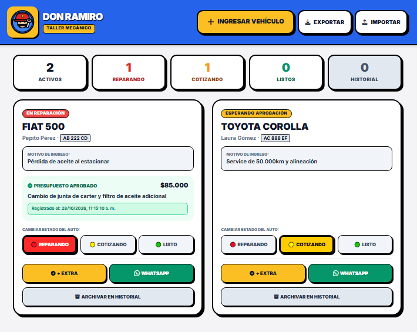
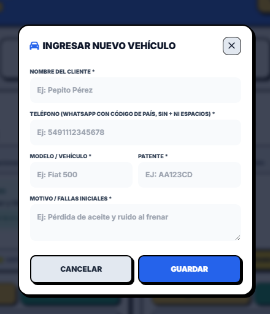
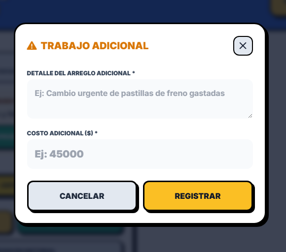
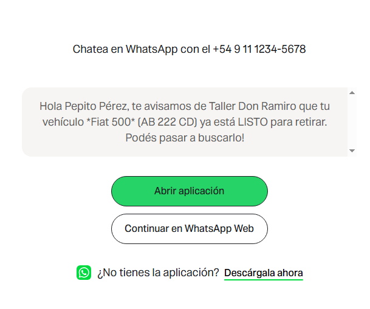
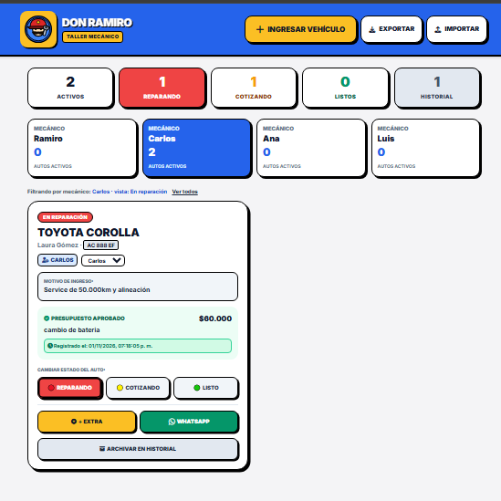

# 🚗 Don Ramiro - Taller Mecánico

**App de Gestión Táctil & Notificaciones WhatsApp**

Una aplicación web **mobile-first** con estilo retro/arcade diseñada para la gestión operativa en tiempo real de talleres mecánicos. Optimizada para entornos de trabajo exigentes: facilita el control visual del estado de los vehículos, la **asignación por mecánico** y las comunicaciones con los clientes vía WhatsApp.

Este proyecto no partió de un prompt genérico.  
Se desarrolló a partir de un **prompt personal**, armado en función de un problema concreto del taller, centrado siempre en las necesidades del cliente, sus prioridades y sus gustos.

Se trabajó con **mega prompting** y **Spec Driven Development**: contexto del proyecto, especificación de features, ICP/user persona y guía de marca.

> Diseño inicial con **Gemini Canvas** · Refactor y especificación con **Grok** · Deploy en **GitHub Pages**.

---

### 🔗 Probar online

**Demo principal (Don Ramiro):** [https://noeliaorsini.github.io/taller-mecanico-don-ramiro-/](https://noeliaorsini.github.io/taller-mecanico-don-ramiro-/)

> La demo de Pages refleja lo publicado en `main`. El feature de asignación de mecánico vive en la rama `feature/asignacion-mecanico` hasta el merge.

---

### Prueba con otra herramienta (Lovable)

El mismo prompt inicial y, después, las **mismas especificaciones** se probaron desde cero en **Lovable**, sin reutilizar el código de este repositorio.

Para diferenciarla de la versión principal de este repo (**Don Ramiro**), esa variante se llama **Don Mario**.

**Demo Lovable (Don Mario):** [https://taller-mecanico-don-mario.lovable.app](https://taller-mecanico-don-mario.lovable.app)

---

## 👤 ICP y user persona

Documento: [`ICP_PERSONA.md`](ICP_PERSONA.md)

- **Perfil:** taller de **4 mecánicos**, con **tablet compartida** en el área de trabajo.
- **Persona principal:** **Ramiro** (referente operativo; ordena ingresos y asignaciones).
- **Equipo:** Ramiro, Carlos, Ana, Luis.

Además de los problemas originales (llamadas, presupuestos extra, interfaz poco táctil), el equipo necesita saber **quién tiene cada auto**.

---

## 🎯 Problema que resuelve

1. **Interrupciones constantes por llamadas** — clientes preguntando si el auto está listo.
2. **Discusiones por presupuestos y trabajos extra** — sin registro claro de aprobación.
3. **Interfaces poco aptas para el taller** — botones chicos, difícil con manos sucias.
4. **Falta de visibilidad del responsable** — en un equipo de 4, no alcanza con el semáforo: hay que ver **quién** trabaja cada unidad.

---

## 💡 Solución

| Función | Descripción |
|--------|-------------|
| **Semáforo de estados** | 🔴 En reparación · 🟡 Cotizando · 🟢 Listo · Historial. El filtro activo se pinta en color sólido para saber en qué vista estás. |
| **Asignación de mecánico** | Al ingresar un auto se asigna obligatoriamente a Ramiro, Carlos, Ana o Luis. Se puede reasignar después. |
| **Panel de equipo** | 4 recuadros con cantidad de autos **activos** por mecánico. Al tocar uno, se filtra por ese mecánico. |
| **Aprobación con marca de tiempo** | Trabajos extra con detalle, costo y registro inalterable de aprobación. |
| **WhatsApp directo** | Un clic abre el chat con mensaje prearmado. |
| **Historial** | Archivar, reactivar o eliminar. El filtro por mecánico también aplica en historial. |
| **Exportar / Importar** | Al exportar se elige: **backup completo** o **solo la vista actual** (filtros activos). Importar reemplaza los datos de la app. |

### Cómo se usan los filtros (en la práctica)

| Qué querés ver | Qué tocás |
|----------------|----------|
| Panorama general | **Activos** (+ “Ver todos” si había filtro de mecánico) |
| Todo lo de un mecánico | **Activos** + recuadro de ese mecánico |
| Solo cotizaciones de uno | **Cotizando** + ese mecánico |
| Historial de uno | **Historial** + ese mecánico |

Spec del feature: [`SPEC_ASIGNACION_MECANICO.md`](SPEC_ASIGNACION_MECANICO.md)  
Checklist de prueba: [`TEST_CHECKLIST_ASIGNACION.md`](TEST_CHECKLIST_ASIGNACION.md)

---

## 📱 Cómo se ve la app

### Flujo original (presupuestos y WhatsApp)

### Pantalla principal (referencia previa)


### Ingresar un vehículo nuevo


### Registrar un trabajo adicional


### Aviso por WhatsApp (mensaje predeterminado)


### Mejora actual: equipo y filtros

Con el feature de asignación, la pantalla suma:

- **4 recuadros de mecánicos** (contadores de autos activos)
- **Filtros de semáforo** con color sólido en la vista activa
- **Badge + selector de mecánico** en cada tarjeta
- Leyenda del tipo: `Filtrando por mecánico: Carlos · vista: En reparación`



*Captura: vista Reparando + filtro Carlos (ICP: tablet compartida, saber quién tiene cada auto).*

Las capturas anteriores documentan el flujo de presupuestos y WhatsApp, que se mantiene.

---

## 💾 Exportar e importar

- **Exportar** pregunta qué guardar:
  - **Aceptar** → solo la **vista actual** (filtros de estado y/o mecánico activos).
  - **Cancelar** → **backup completo** de todos los vehículos, incluido el historial.
- **Importar** carga un archivo JSON y **reemplaza** los datos actuales de la app (pide confirmación antes).
- Si el archivo es antiguo y algún vehículo no tiene mecánico, al importar se le asigna **Ramiro** por defecto.

## 🔒 Privacidad y almacenamiento (versión beta)

- Datos solo en el navegador (`localStorage`).
- Sin servidores ni cuentas obligatorias.
- Exportar / Importar para backup o cambio de dispositivo.
- Uso interno / ejercicio de curso; si hubiera nube en el futuro, harían falta avisos formales.

---

## 🎨 Diseño

- Estilo arcade / neobrutalista (bordes negros, sombras duras)
- Mobile-first y táctil (botones ≥ 48px)
- Semáforo legible: vista activa en color sólido; el resto en blanco con número de color
- Mecánico seleccionado resaltado en azul (para no confundirlo con el semáforo)

---

## 🛠️ Tecnologías

| Tecnología | Uso |
|-----------|-----|
| HTML5 | Estructura |
| CSS3 + Tailwind CSS | UI responsive |
| JavaScript ES6+ | Estado, filtros, marcas de tiempo |
| LocalStorage | Persistencia local |
| Font Awesome / Inter | Iconos y tipografía |
| wa.me | WhatsApp |

---

## 📁 Estructura del proyecto

```
taller-mecanico-don-ramiro-/
├── index.html
├── css/
│   └── styles.css
├── js/
│   └── app.js
├── assets/
│   ├── don_ramiro.png
│   ├── ingresar.png
│   ├── trabajo_adicional.png
│   ├── whatsapp.png
│   └── panel_mecanicos_filtro.png
├── AGENT_CONTEXT.md
├── SPEC_PRESUPUESTOS.md
├── SPEC_ASIGNACION_MECANICO.md
├── ICP_PERSONA.md
├── TEST_CHECKLIST_ASIGNACION.md
├── BRAND_SKILL.md
├── README.md
└── .gitignore
```

---

## 📱 Cómo probar la aplicación

1. Demo online (tras merge) o `index.html` local **con** carpetas `js/` y `css/`.
2. **INGRESAR VEHÍCULO** — completar datos y **elegir mecánico** (obligatorio).
3. Revisar el **panel de 4 mecánicos** y los contadores.
4. Filtrar por estado (semáforo) y por mecánico; comprobar la leyenda de filtro.
5. Cambiar mecánico desde la tarjeta.
6. **+ EXTRA**, aprobación con marca de tiempo, **WHATSAPP**.
7. **ARCHIVAR** / Historial / eliminar.
8. **EXPORTAR**: elegir backup completo o solo la vista actual (filtros).
9. **IMPORTAR**: reemplaza los datos actuales por el archivo JSON.

Detalle: `TEST_CHECKLIST_ASIGNACION.md`.

---

## 🚀 Uso local

```bash
python -m http.server 8000
```

---

## 🔮 Posibles mejoras a futuro

- PIN o usuario por mecánico
- Backend liviano / sync entre dispositivos
- Backup automático a Google Drive
- PDF de trabajos y aprobaciones
- Búsqueda por patente o cliente
- PWA / offline más robusto

---

**Hecho con ❤️ para el taller de Don Ramiro**  
Diseñado con Gemini Canvas · Refactorizado con Grok

---

**Autora:** Noelia Orsini  
Desarrolladora · Abogada · Counselor  

[LinkedIn](https://linkedin.com/in/noelia-orsini) · [Portafolio](https://noelia-orsini-portafolio.lovable.app/)
