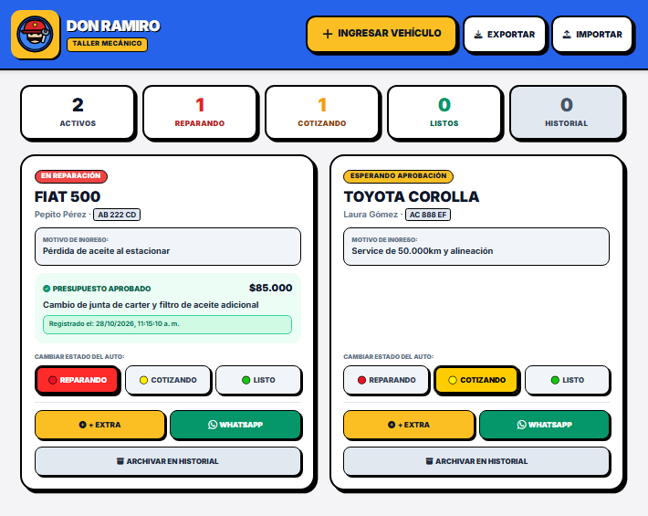
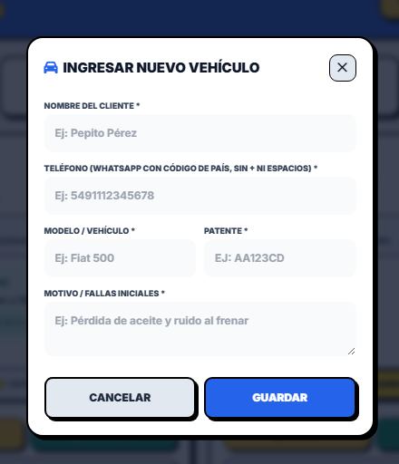
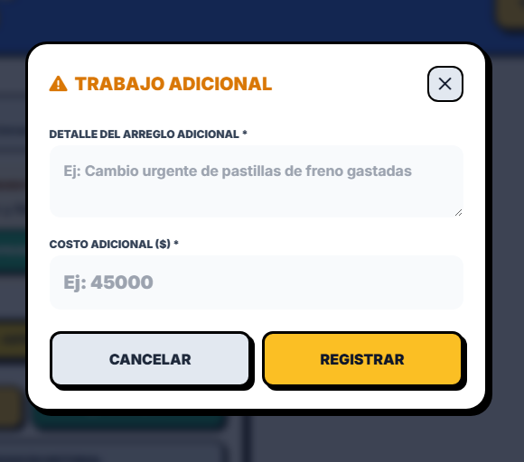
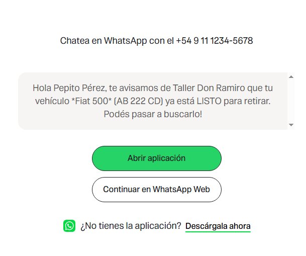

# 🚗 Don Ramiro - Taller Mecánico

**App de Gestión Táctil & Notificaciones WhatsApp**

Una aplicación web **mobile-first** con estilo retro/arcade diseñada para la gestión operativa en tiempo real de talleres mecánicos. Optimizada para entornos de trabajo exigentes: facilita el control visual del estado de los vehículos y automatiza las comunicaciones con los clientes vía WhatsApp.

> Diseñada originalmente con **Gemini Canvas** y refactorizada con **Grok**.

---

### 🔗 Probar online

**Demo:** [https://noeliaorsini.github.io/taller-mecanico-don-ramiro-/](https://noeliaorsini.github.io/taller-mecanico-don-ramiro-/)

---

## 🎯 Problema que resuelve

En la operativa diaria de un taller mecánico aparecen tres fricciones principales que afectan la productividad y la relación con los clientes:

1. **Interrupciones constantes por llamadas**  
   Los clientes llaman o escriben reiteradamente para preguntar si su vehículo ya está listo, interrumpiendo el trabajo de los mecánicos.

2. **Discusiones por presupuestos y trabajos extra**  
   Al desarmar un vehículo suelen aparecer fallas adicionales. Cuando no existe un registro claro de la aprobación del cliente, se generan desacuerdos sobre los costos al momento del retiro.

3. **Interfaces poco aptas para el taller**  
   Las pantallas tradicionales con texto pequeño o botones estrechos son difíciles de usar con manos sucias, en movimiento o desde el celular del taller.

---

## 💡 Solución

**Don Ramiro** resuelve estas problemáticas con una plataforma de **un solo toque (one-tap)** pensada específicamente para la dinámica del taller:

| Función | Descripción |
|--------|-------------|
| **Semáforo de estados** | 🔴 En reparación · 🟡 Cotizando / Esperando aprobación · 🟢 Listo para retirar |
| **Aprobación con marca de tiempo** | Al detectar un trabajo extra se registra detalle y monto. La app guarda fecha, hora y segundo exactos de la autorización del cliente → registro auditable. |
| **WhatsApp directo (wa.me)** | Botones de un toque que abren WhatsApp con mensajes preescritos para pedir aprobación o avisar que el auto está listo. |
| **Diseño táctil neobrutalista / arcade** | Botones grandes (mín. 48 px), tipografía bold y alto contraste para toques precisos desde el celular. |
| **Historial y archivado** | Los vehículos entregados se archivan (no se eliminan) para consultar garantías sin saturar el panel diario. |
| **Exportar / Importar** | Backup en archivo JSON para compartir entre dispositivos o guardar historial fuera de la app. |

---

## 📱 Cómo se ve la app

### Pantalla principal


### Ingresar un vehículo nuevo


### Registrar un trabajo adicional


### Aviso por WhatsApp (mensaje predeterminado)


---

## 🔒 Privacidad y almacenamiento (versión beta)

Esta es una **versión beta de uso interno** pensada como ejercicio de curso y herramienta de taller.

- Los datos se guardan **únicamente en el navegador del dispositivo** (`localStorage`).
- **No se envían a ningún servidor** ni a servicios en la nube.
- No se requiere cuenta, login ni conexión a internet para funcionar (salvo WhatsApp).
- Cada dispositivo mantiene su propia copia de los datos.
- Para compartir información entre celulares o hacer respaldo se usa **Exportar / Importar** (archivo JSON).

> Al ser de uso interno y no recolectar ni transmitir datos personales a terceros, no se implementó una política de privacidad formal en esta versión beta.  
> Si en el futuro se agregara un backend o almacenamiento en la nube, correspondería incorporar avisos y políticas adecuadas.

---

## 🎨 Diseño

- **Estilo**: Neobrutalism / Arcade (bordes negros gruesos, sombras duras, colores vivos)
- **Enfoque**: Mobile-first y táctil
- **Tipografía**: Inter (Google Fonts)
- **Iconografía**: Font Awesome
- **Feedback visual**: Botones con efecto “presión” al tocar + toasts de confirmación
- **Colores semáforo**:
  - 🔴 Rojo → En reparación
  - 🟡 Amarillo → Cotizando / Esperando aprobación
  - 🟢 Verde → Listo para retirar

---

## 🛠️ Tecnologías utilizadas

| Tecnología | Uso |
|-----------|-----|
| **HTML5** | Estructura semántica |
| **CSS3 + Tailwind CSS** | Estilos y diseño responsive mobile-first |
| **JavaScript ES6+** | Lógica de estado, DOM y marcas de tiempo |
| **LocalStorage API** | Persistencia local sin servidor ni base de datos |
| **Font Awesome** | Iconos |
| **Google Fonts (Inter)** | Tipografía |
| **wa.me** | Enlaces directos a WhatsApp |

---

## 📁 Estructura del proyecto

```
taller-mecanico-don-ramiro-/
├── index.html              # Página principal
├── css/
│   └── styles.css          # Estilos arcade / neobrutalism
├── js/
│   └── app.js              # Lógica de la aplicación
├── assets/
│   ├── don_ramiro.png      # Captura pantalla principal
│   ├── ingresar.png        # Captura modal ingreso
│   ├── trabajo_adicional.png
│   └── whatsapp.png
├── AGENT_CONTEXT.md        # Contexto para el agente (Spec Driven Development)
├── SPEC_PRESUPUESTOS.md    # Especificación del feature principal
├── BRAND_SKILL.md          # Guía de marca y diseño
├── README.md
└── .gitignore
```

---

## 📱 Cómo probar la aplicación

1. Entrá a la [demo online](https://noeliaorsini.github.io/taller-mecanico-don-ramiro-/) o abrí el archivo `index.html`.
2. Presioná **INGRESAR VEHÍCULO** y completá el formulario.  
   > 💡 Para probar WhatsApp con tu celular, ingresá tu número en formato internacional limpio (sin espacios ni ceros).  
   > Ejemplo Argentina: `5491112345678`
3. Cambiá el estado del auto con los botones del semáforo (🔴 🟡 🟢).
4. Agregá un trabajo adicional con **+ EXTRA** → el auto pasa automáticamente a amarillo.
5. Confirmá la aprobación del cliente (se genera la marca de tiempo) y luego pasalo a ROJO con el botón del semáforo.
6. Presioná **WHATSAPP** para abrir la conversación con el mensaje preescrito.
7. Al finalizar, usá **ARCHIVAR EN HISTORIAL**.
8. Desde el **Historial** podés **REACTIVAR** o **ELIMINAR** definitivamente un vehículo.
9. Usá **EXPORTAR** para descargar un backup JSON y **IMPORTAR** para cargarlo en otro dispositivo.

---

## 🚀 Cómo usarlo localmente

### Opción 1 – Abrir directamente
Descargá o cloná el repositorio y abrí `index.html` en el navegador.

### Opción 2 – Servidor local
```bash
# Python
python -m http.server 8000

# o con Node
npx serve .
```
Luego abrí: [http://localhost:8000](http://localhost:8000)

---

## 🔮 Posibles mejoras a futuro

- Autenticación simple por PIN o usuario para varios empleados
- Backend liviano (Supabase / SQLite) si se necesita sincronización entre dispositivos
- **Backup automático a Google Drive** (u otro almacenamiento de la cuenta del usuario), para que los datos no se pierdan si se borran las cookies/caché del navegador o si se olvida exportar manualmente
- Generación de comprobante/PDF de trabajos y aprobaciones
- Filtro por fecha y búsqueda por patente o cliente
- Modo offline más robusto (PWA + service worker)
- Integración más avanzada con WhatsApp Business API
- Roles (mecánico / administración) con permisos distintos

---

## 📌 Nota

Los datos se guardan únicamente en el navegador (`localStorage`). Si se limpia la caché se pierden, por eso se recomienda usar **EXPORTAR** periódicamente. Ideal para usar en una **tablet o celular del taller**.

---

**Hecho con ❤️ para el taller de Don Ramiro**  
Diseñado con Gemini Canvas · Refactorizado con Grok

---

**Autora:** Noelia Orsini  
Desarrolladora · Abogada · Counselor
